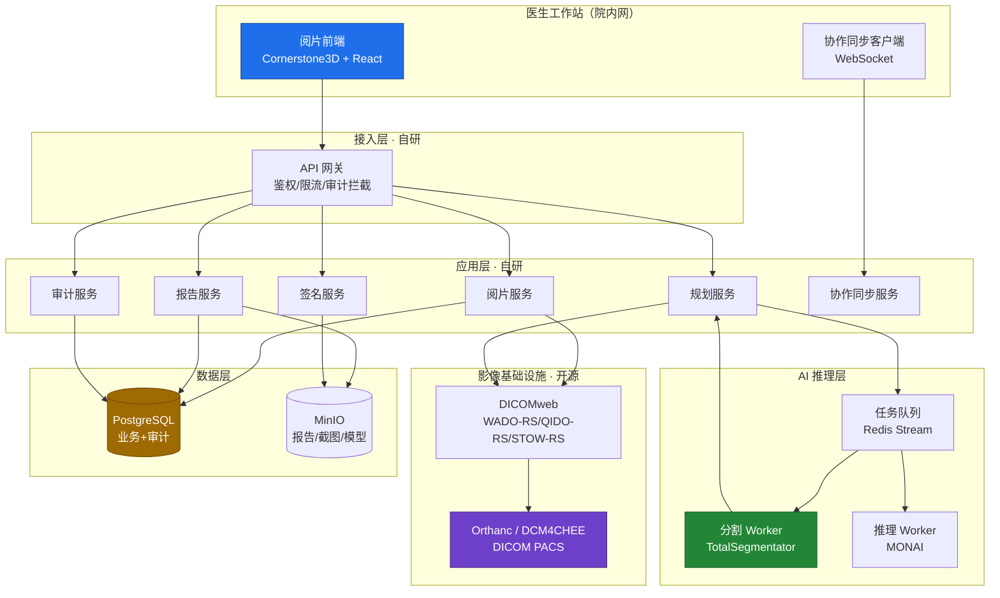
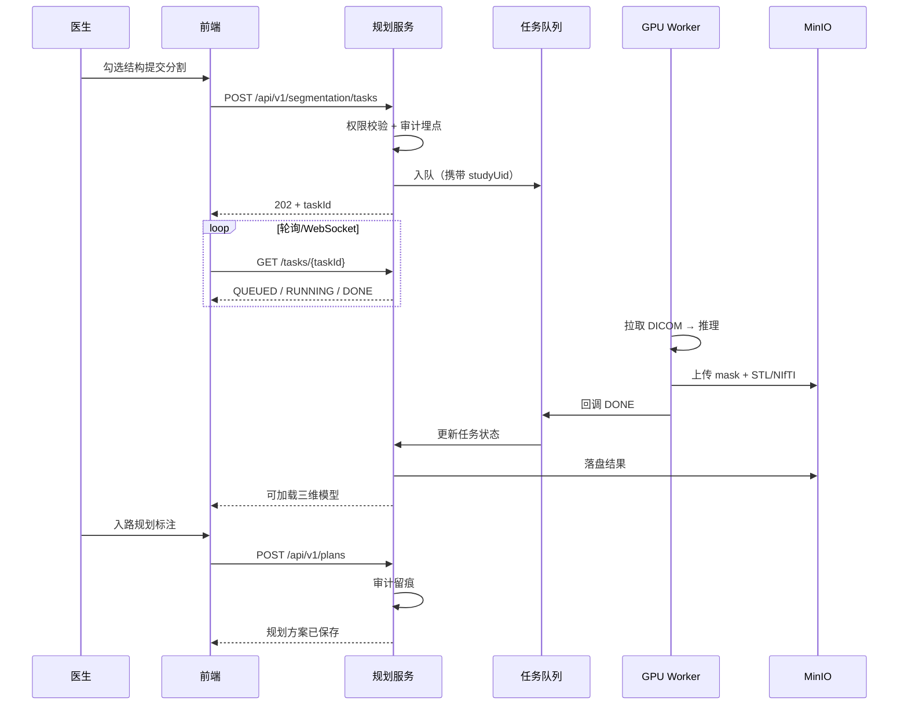
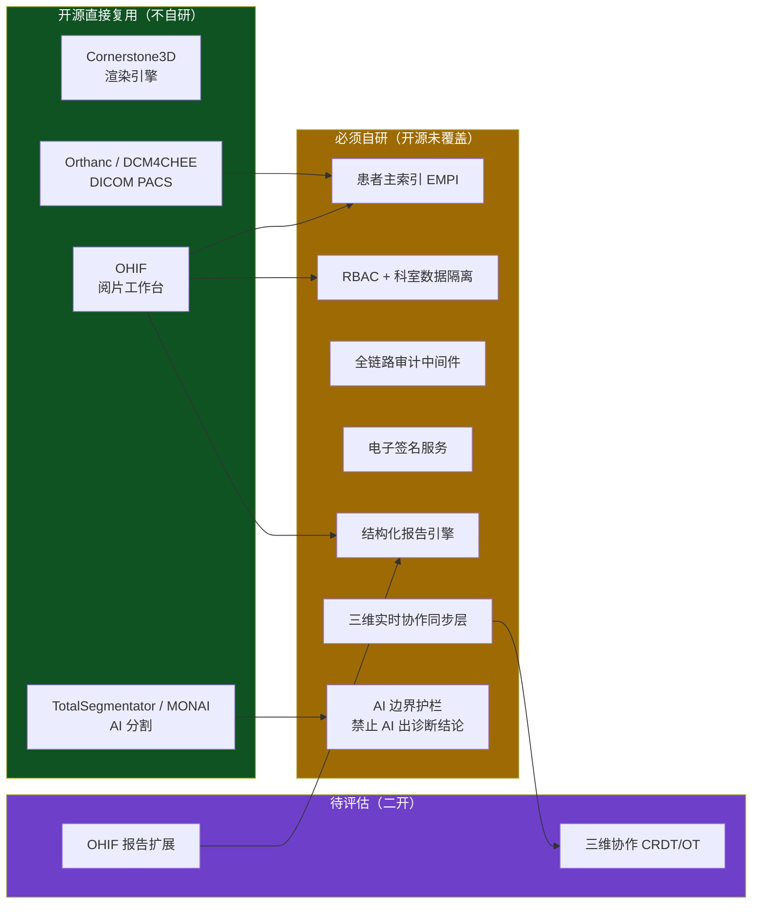
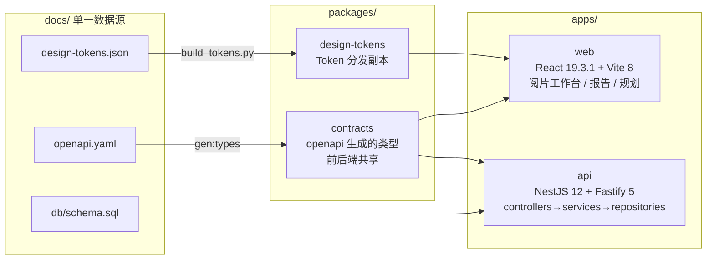

# MedPlan — 企业级医学影像阅片与手术规划系统

> 一句话：面向院内影像科的私有化部署阅片与手术规划平台，用**开源做内核、自建合规壳**，满足等保 2.0 三级与卫健委电子病历管理规范。

[](https://github.com/Michael522020/medplan/actions/workflows/contract-guard.yml)
[](LICENSE)
[](https://nodejs.org)
[](https://www.postgresql.org)
[](https://www.typescriptlang.org)

**门禁现状**：980 条静态断言 · 13 条编译期负向断言 · 23 组真实 PostgreSQL 18 验证 · 全部可复现

---

## ⚠️ 使用前必读

**本项目是工程实现与设计参考，不是医疗器械，不可直接用于临床诊断。**

| 项 | 说明 |
|---|---|
| 临床适用性 | **无**。开源许可不构成任何临床适用性承诺 |
| 合规状态 | **未认证**。等保测评、密评、器械注册（如涉及）均需部署方自行完成 |
| AI 能力边界 | AI **只做辅助标记与量化指标**（分割/测量/三维重建），**不出具诊断结论**。依据《人工智能医疗器械注册审查指导原则》（器审中心 2022 年第 8 号），这些能力属非辅助决策类（工具类） |
| 诊断责任 | 诊断结论由执业医师确认并以 CA 数字证书电子签名后方可生效 |

**部署前必须自行完成**：网络安全等级保护测评（三级）、商用密码应用安全性评估（密评）、
医疗器械注册（如业务触及辅助决策类）、数据安全与个人信息保护合规审查、院内系统对接与安全配置。

---

## 为什么要开源

市面上的影像 AI 产品要么闭源（无法按等保条款逐项二开），要么只做纯技术不做合规。
**技术不是壁垒，合规才是。**

本仓库主要贡献的是「**合规怎么落地**」的可复用实现：

| 能力 | 实现要点 |
|------|---------|
| 审计表物理不可改 | 权限层（REVOKE）+ 触发器层（含 TRUNCATE 语句级）+ hash chain 三层递进，**整表重建也可检出** |
| 越权响应不可区分 | 10004 与 10005 的响应时间、状态码、响应体大小三者一致，避免成为「患者存在性预言机」 |
| AI 合规边界编译期强制 | `additionalProperties: false` + 13 条 `@ts-expect-error` 负向断言 —— **靠编译器守，不靠人守** |
| 电子签名绑定与失效 | SM3 摘要绑定正文，改一字符签名即失效；服务端权威锁定标志防前端绕过 |
| 设计 Token 单一数据源 | JSON 是唯一权威，CSS 由脚本生成，三处副本由门禁校验不漂移 |

**980 条静态断言 + 13 条编译期负向断言 + 23 组真实数据库执行验证**，全部可在 CI 复现，本地 `npm run verify:db:local` 秒级出结果。

---

## 一、项目定位

| 维度 | 说明 |
|------|------|
| 目标用户 | 影像科医师 / 手术科室医师 / 质控科 / 院方信息科 |
| 核心链路 | DICOM 调阅 → 多平面阅片 → AI 自动分割 → 三维入路规划 → 结构化报告 → 医师电子签名 → 归档留痕 |
| 部署形态 | 院内私有化 Kubernetes，**无外网依赖**（数据不出院） |
| 合规底线 | 等保 2.0 三级、卫健委电子病历应用管理规范、病历管理管理规定、互联互通标准化成熟度 |
| AI 边界 | AI **只做辅助标记与量化指标**，不出具诊断结论；诊断结论由执业医师确认并电子签名 |
| 技术栈 | React 19.3.1 + Cornerstone3D 5.13.2 + NestJS 12.2.0 + PostgreSQL 18（详见 `docs/Spec.md` §4） |
| 许可 | Apache-2.0。依赖许可详见 `docs/licenses/THIRD-PARTY.md`（**注意 TotalSegmentator 部分模型权重为 NC 条款**） |

---

## 二、整体架构



---

## 三、核心业务时序（AI 分割任务）



---

## 四、文档索引

| 文档 | 说明 |
|------|------|
| `docs/Spec.md` | **规格契约**（15 章）：锁定范围 / API / 表 / 页面 / Token / 验收标准。开发唯一依据 |
| `docs/PRD.md` | 用户故事、功能需求、合规需求映射、验收标准 |
| `docs/架构方案.md` | 选型矩阵、分层架构、DB Schema、风险缓解 |
| `docs/UIUX.md` / `docs/UIUX-P2.md` | 设计契约 + 页面级规格（7 页 × 7 要素，42 组件，126 快捷键） |
| `docs/openapi.yaml` | OpenAPI 3.0 契约（12 端点 / 63 schema），前后端唯一依据 |
| `docs/db/schema.sql` / `docs/db/migrations/` | PostgreSQL 18 DDL 与可执行迁移 |
| `docs/db/manual-verify.md` | 数据库真实执行验证手工清单（无 PG 环境时的等效替代） |
| `docs/design-tokens.json` / `.css` | 设计 Token 唯一数据源（JSON 是权威，CSS 由脚本生成） |
| `docs/decisions/ADR-*.md` | 架构决策记录（MADR 格式，9 条） |
| `docs/licenses/THIRD-PARTY.md` | 第三方依赖许可清单（**公开仓必读**） |
| `docs/DECISIONS-NEEDED.md` | 待确认决策清单 |
| `compliance/` | 等保三级与卫健委条款逐条对照表 |
| `.workbuddy/memory/` | 开发过程记忆：踩坑记录与未决登记册（**非产品代码，见该目录的 README**） |

---

## 五、开源内核与自研边界



**核心判断**：开源清单覆盖了「能不能做」，但完全没覆盖「能不能上线」。合规外壳（EMPI / 权限 / 审计 / 电子签名 / AI 边界）才是本项目的主要工作量。

---

## 六、工程结构与当前进度



| Phase | 状态 | 产出 |
|-------|------|------|
| Phase 0 需求澄清 | 已完成 | 核心需求 3 句话 + 合规底线 |
| Phase 1 并行调研 | 已完成 | PRD / 架构方案 + 7 份 ADR / UIUX |
| Phase 1.5 Spec 生成 | 已完成 | `docs/Spec.md`（15 章，规格即契约） |
| Phase 2 设计细化 | 已完成 | `openapi.yaml` / `schema.sql` / 迁移 / `UIUX-P2.md` |
| **Phase 3 并行开发** | **进行中** | 前后端 12 端点 + 4 页面已实现，门禁工具链完备 |
| Phase 4 测试交付 | **进行中** | QA 独立验证 + 运维交付编排 |

---

## 七、快速开始

> 本节是**外部贡献者第一次上手**的完整路径。所有命令都在 Linux / macOS / Windows
> (Git Bash) 下实测通过。

### 前置

| 工具 | 版本 | 说明 |
|------|------|------|
| Node.js | **22.x（>=22.12.0，<23）** | Vite 8 要求 >=22.12.0。**不要升到 24** —— 见 `docs/decisions/ADR-008.md` |
| npm | >=10 | 随 Node 22 附带 |
| Docker | 任意近期版本 | 只有跑数据库验证才需要 |
| PostgreSQL | 18 | 只有不用 Docker 时才需要 |

### 四步跑起来

```bash
# 1. 装依赖
npm ci

# 2. ★ 生成契约类型 —— 必须先做这一步
npm run gen:types

# 3. 自检（应当全绿）
npm run lint        # 968 条静态断言
npm run typecheck   # 前后端类型检查 + 13 条编译期负向断言

# 4. 构建
npm run build:web
```

### ⚠️ 第 2 步为什么是必须的

`packages/contracts/src/generated/` **不入库**（`.gitignore` 里有）——
生成的类型必须与 `docs/openapi.yaml` 严格同步，进了版本库就会出现
「契约改了但类型没改」的静默漂移。

因此**契约类型由 `npm run gen:types` 从 `docs/openapi.yaml` 现场生成**。

跳过这一步的症状：`tsc` 报
`Cannot find module './generated/api-types'`，
并连带出现一批 `TS7006: Parameter 'x' implicitly has an 'any' type`
（类型缺失导致派生类型全部塌陷成 any，**这些不是真 bug**）。

`npm run typecheck` 内部已经包含 `gen:types`，所以如果你只跑 typecheck 可以跳过第 2 步；
但单独跑 `tsc` 或 IDE 里看到一片红时，先跑它。

### 跑数据库验证（可选）

```bash
npm run verify:db:local
```

会自动起 PostgreSQL 18 容器、执行迁移、跑 23 组验证、清理容器，**秒级出结果**。

### 目录速查

```
apps/web/          React 19 + Vite 8 阅片工作台
apps/api/          NestJS 12 + Fastify 5 业务服务
packages/contracts/    契约类型（生成的，不入库）
packages/design-tokens/ 设计 Token 分发副本
docs/              Spec / 契约 / DDL / ADR / UIUX
scripts/           门禁脚本 + 运维脚本
deploy/            容器编排（见 docs/ops/RUNBOOK.md）
```

---

## 八、契约门禁（开发期强约束）

```bash
npm run lint              # 980 条静态断言
npm run typecheck         # 前后端类型检查 + 13 条编译期负向断言
npm run build:web         # 前端真实构建
npm run verify:db:local   # 本地 Docker 起 PG18 跑真实执行验证（秒级，需 Docker）
npm run verify:db         # 真实执行验证（CI 用，需本机有 PG18）
npm run recall:pitfalls   # 按技术栈指纹召回本项目已知坑
```

| 门禁 | 断言数 | 守护什么 |
|------|-------|---------|
| `lint:openapi` | 560 | 契约结构、x-audit 覆盖、AI 字段黑名单、幂等头 |
| `lint:schema` | 191 | DDL 结构、卫健委字段覆盖、权限与分区 |
| `lint:migrations` | 155 | 迁移与 schema 逐列比对、运行时分区默认权限、**append-only 语义**、**触发器引用带 schema 前缀** |
| `lint:tokens` | 17 | Token 三处副本同步、Canvas 恒暗、危急值可区分 |
| `lint:icons` | 6 | 图标名真实存在、无 emoji、无第二套图标库 |
| `lint:css-vars` | 3 | CSS 变量引用均已定义（防静默失效） |
| `lint:publish` | 16 | 公开仓脱敏：无凭证、无内网地址、无未打码身份、许可清单完整 |
| `lint:viewer-boundary` | 7 | 阅片区封装层边界（core/ 外禁止直连 Cornerstone、`preferSizeOverAccuracy` 写死 true） |
| `lint:bundle` | 6 | 产物体积：入口 chunk 不内联 Cornerstone（4MB 按需加载） |
| `lint:shell` | 7 | .sh 必须 LF + 有 shebang + git mode 100755 |

**为什么合规边界写在契约里而不是文档里**：纪律靠人守，类型和断言靠 CI 守。
`SegmentationStructure.additionalProperties: false` + `required: [structureName, structureLabelZh, volumeMl, confirmed]`
使得任何人往 AI 输出契约里加 `nature` / `malignancy` 字段，`tsc --strict` 立即失败。

CI 配置见 `.github/workflows/contract-guard.yml`，每次 push / PR 强制执行，
并起 PostgreSQL 18 服务容器跑真实执行验证。

### 数据库验证：本地比 CI 快

数据库的**运行时行为**（分区路由、触发器是否生效、REVOKE 是否真挡住、
扩展函数能否解析）只有真跑一次才知道。本项目提供本地通道：

```bash
npm run verify:db:local    # 自动起 PG18 容器 -> 跑 23 组验证 -> 清理容器
```

**秒级出结果**。这一点很重要 —— 2026-10-27 那次修复连续三轮 CI
（每轮约 2 分钟，且失败要等下一轮才能拿到诊断）才定位到根因。
CI 保留作为最终把关，但不再是唯一的反馈通道。

验证覆盖 23 组：审计表物理不可改（REVOKE + 触发器双层）、hash chain 衔接与完整性、
分区兜底、卫健委必备字段覆盖、AI 模型版本锁、最小权限（ai_worker 无 PHI 表权限）、
幂等键唯一约束。

### 已知环境警告（不必处理）

`npm install` 会输出 `EBADENGINE: @cornerstonejs/codec-libjxl 要求 node>=24`。
这是**误报** —— 该包是纯 WebAssembly，在浏览器端加载。调查过程与结论见
`docs/decisions/ADR-008.md`。运行时锁定 Node 22 LTS。

### Phase 3 检查清单

| # | 检查项 | 状态 |
|---|--------|------|
| 1 | `npm run lint` 全绿 | **968/968 通过** |
| 2 | `npm run typecheck` 通过 | 通过（13 条负向断言） |
| 3 | `npm run build:web` 真实构建 | 通过（入口 57KB，Cornerstone 4MB 按需加载） |
| 4 | monorepo 骨架 | 已建（apps/web + apps/api + packages/contracts + packages/design-tokens） |
| 5 | 12 个 API 端点实现 | **全部实现**，路由与 openapi 逐条比对零缺失零多余 |
| 6 | 4 个页面实现 | login / worklist / viewer / reports 已实现 |
| 7 | 后端单元测试 | 36 条全绿（覆盖四条安全约束 + 幂等 + 校验器） |
| 8 | `verify:db` 真实执行 | **23/23 通过**（本地 Docker PG18 + CI 服务容器双通道） |
| 9 | 公开仓 | 已发布 `Michael522020/medplan`（Apache-2.0，PUBLIC） |
| 10 | GPU 现状确认 | 待用户确认（无 GPU 则 AI-01 降级 P1） |
| 11 | CA / TSA / 密码机采购启动 | 待启动（周期最长，提前 2 个月） |
| 12 | 互联互通目标等级确认 | 待确认（四甲 or 仅三级等保） |
| 13 | 真实 PACS 联调 | 待院内环境（WADO-RS 响应体形态需实测） |

### 已知外部依赖（需院内环境，当前为 fail-closed 占位）

以下适配器**端口与错误语义已就位**，未配置时全部 fail-closed
（签名不可用、吊销查不到按吊销处理），但需接院内真实服务：

| 适配器 | 依赖 | 现状 |
|---|---|---|
| `UkeyCertificateProvider` | CA 证书查询服务 | 端口就位，需院内 CA |
| `TsaClient` | TSA 时间戳服务 | 端口就位 + NTP 漂移数学已用模拟服务器验证 |
| `RevocationChecker` | CRL / OCSP 分发点 | 端口就位 |
| PACS 取图 | dcm4chee-arc-light | 端口就位，需真实 PACS |
| Redis Stream 入队 | Redis | **未实现**（任务落库后 status='queued'，投递通道待与 AI 模块负责人确认） |

