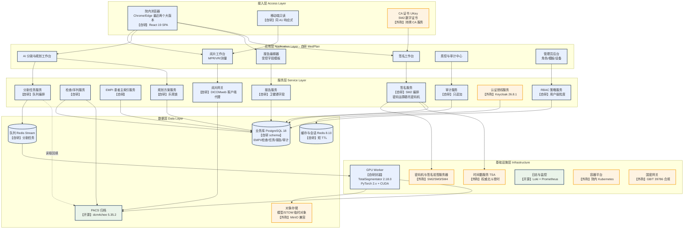
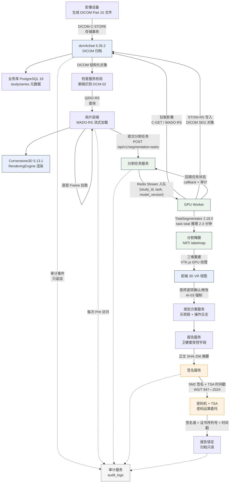
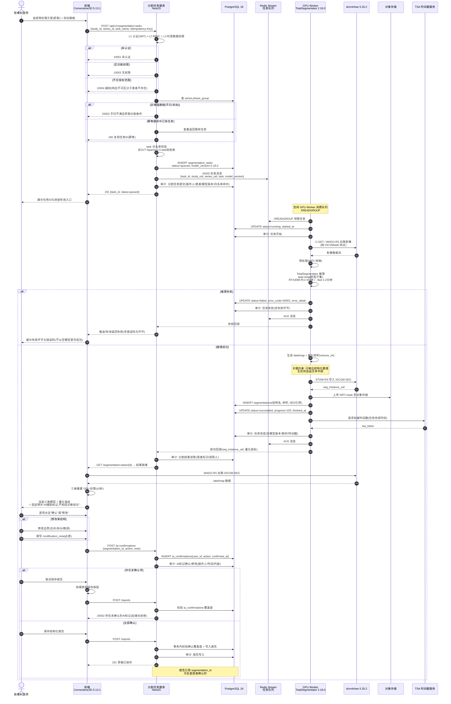
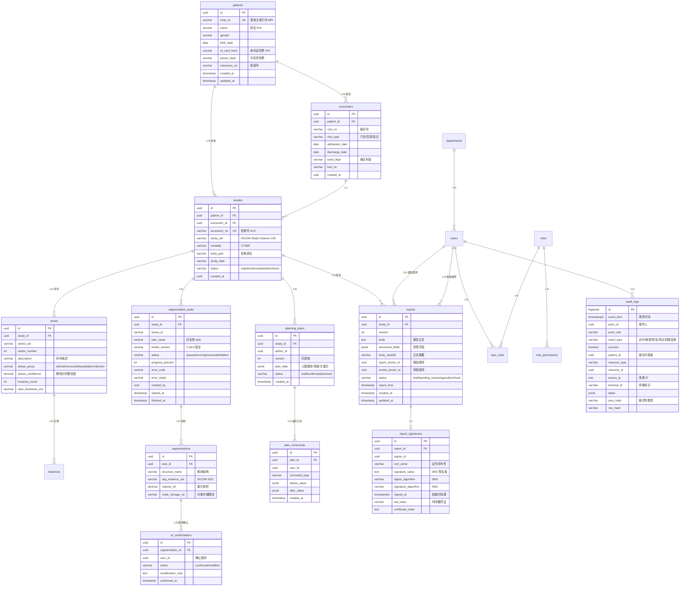
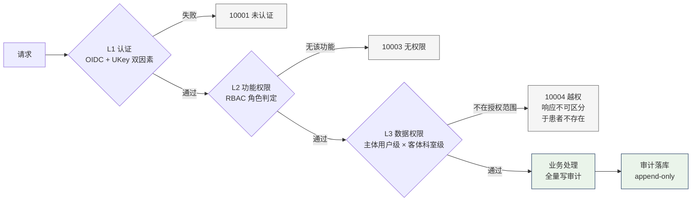

# MedPlan 架构方案

> 企业级医学影像阅片与手术规划系统 — 架构设计与技术选型
> 文档版本：v1.0
> 编写人：高见远（首席架构师）
> 适用范围：私有化部署，满足等保三级、卫健委电子病历规范、WS/T 847—2024 医学电子文档数字签名标准
> 效力说明：本文件是技术选型与架构契约的**单一事实来源**。后续前后端实现必须按第 4 章「技术栈锁定表」中标注的确切版本执行；实现与本文件冲突时，先改本文件再改代码。

---

## 0. 文档阅读指引

| 读者 | 必读章节 |
|------|---------|
| 前端开发 | 第 3 章、第 5 章、第 8 章、第 10 章 |
| 后端开发 | 第 3 章、第 5 章、第 6 章、第 7 章、第 10 章 |
| AI 工程师 | 第 3 章、第 5 章、第 9 章 |
| 安全与合规 | 第 7 章、第 10 章、第 11 章 |
| 项目总监 | 第 2 章、第 4 章、第 12 章 |

**本文件与其他文档的关系**：需求边界以 `docs/PRD.md` 为准，交互以 `docs/UIUX.md` 为准，架构决策以本文件为准。三者冲突时以 PRD 为准，并同步修订本文件。

---

## 1. 架构设计的前提与约束

### 1.1 硬约束（不可协商）

| 编号 | 约束 | 来源 |
|------|------|------|
| C1 | 数据不出院内网，不依赖公网服务 | PRD OOS-07、等保三级 |
| C2 | AI 只输出分割掩膜与量化指标，不产出诊断结论 | PRD AI-03、国家药监局器审中心通告 2022 年第 8 号（非辅助决策定义） |
| C3 | 报告电子签名须符合《电子签名法》与 WS/T 847—2024 | L1 卫健办医发〔2017〕8 号 |
| C4 | 全部 PHI 访问须可审计，留存不少于 6 个月（病历按 30 年） | GB/T 22239-2019 8.1.4.3、L4 国卫医发〔2013〕31 号 |
| C5 | 采用国密算法 SM2/SM3/SM4，需通过密评 | 《商用密码管理条例》、GB/T 39786-2021 |
| C6 | 越权访问不得泄露患者在本院存在检查的事实 | PRD COM-03 |

### 1.2 本架构明确不解决的问题

- 不替换院内现有 PACS，本产品通过 DICOMweb 标准协议只读接入（PRD OOS-04）
- 三维模型多人实时协作标注列为 v2.0（PRD OOS-03），本方案仅在第 6.5 节给出**演进预留设计**，不实现
- 不做科研脱敏数据集导出（PRD OOS-08）

---

## 2. 选型对比矩阵

### 2.1 PACS 归档层选型（决策点：dcm4chee-arc-light）

用户输入的 OSS 清单把 DCM4CHEE 定位为「企业级生产可用」但未给出选型理由，Orthanc 定位为「轻量级首选」。这两个定位在**本项目的真实约束下**结论是相反的，因此必须重新论证。

约束维度：单院私有化、500 万幅影像容量、5 年留存、等保三级、要求 DICOMweb 完整支持（QIDO/WADO/STOW 三件套）、影像科真实阅片场景。

| 维度 | **dcm4chee-arc-light 5.35.2** | Orthanc 1.12.9 + 插件 | 厂商 PACS（GE/西门子/飞利浦） |
|------|------|------|------|
| 技术栈 | Java / Jakarta EE，PostgreSQL | C++ 自研，插件体系 | 闭源 |
| 功能覆盖（企业生产） | DICOM C-STORE/QUERY/GET/MOVE 完整；DICOMweb 三件套原生；HL7 v2 原生；内置审计与工作流引擎 | DICOMweb 需另装 dicomweb 插件 1.21；HL7 需自建 | 功能完整 |
| DICOMweb 成熟度 | 原生 QIDO-RS/WADO-RS/STOW-RS | 通过插件提供，插件版本需与主程序严格配套 | 视厂商，部分仅支持部分端点 |
| 容量与并发 | PostgreSQL 支撑千万级索引，可水平扩展 | 单实例纵向为主，大规模需自建 sharding | 强 |
| 许可证 | MPL-2.0（弱著佐权，商业友好） | **GPLv3**（强著佐权，见 11.1 风险 R2） | 商业授权 |
| 运维复杂度 | 中（Java 应用 + PostgreSQL，需 JVM 调优） | 低（单进程，配置文件驱动） | 高（厂商依赖） |
| 私有化适配 | 容器化成熟，可信/国产化环境适配良好 | 容器化成熟，轻量 | 信创适配差 |
| 开发成本（自研部分） | 约 1.5 人月对接与调优 | 约 2.5 人月（需自建 HL7、审计、队列） | 约 3 人月（对接 SDK） |
| 长期维护风险 | 中（社区活跃，Java 生态稳定） | 中（社区稳定但小众，关键插件依赖单一维护者） | 高（厂商锁定，版本迭代不可控） |
| 团队技能匹配 | 需 Java 背景（可接受，配置化为主） | 需 C++/运维背景 | 需厂商接口文档 |

**决策：采用 dcm4chee-arc-light 5.35.2 作为 PACS 归档层。**

理由（三条硬理由，非偏好）：
1. **许可证**：Orthanc 的 GPLv3 与闭源商业交付不兼容。虽然纯内部使用不触发 GPL 分发义务，但影像文件会在前后端之间流转、商业交付形态难以界定，GPL 传染风险不可控。dcm4chee 的 MPL-2.0 对文件级弱著佐权，允许闭源集成。
2. **HL7 v2 是国内医院刚需**：国内 HIS/RIS 对接以 HL7 v2 MLLP 为主流（FHIR 在国内东三省三甲覆盖率提升中，见 PRD L3 互联互通测评）。dcm4chee 内置 HL7 v2 与监听器配置，无需自建；Orthanc 需从零实现消息路由。
3. **PostgreSQL 双写收益**：dcm4chee 的元数据落在 PostgreSQL，可**复用同一 PostgreSQL 实例做业务库**（不同 schema，物理隔离可选），审计与业务查询共用备份策略，减少一套运维。

配套要求：数据库若采用独立实例，需在部署文档中明确说明；采用同实例多 schema 时需评估 PACS 元数据表对业务库性能的影响。

---

### 2.2 前端渲染方案选型（决策点：自研 Cornerstone3D 封装）

这是本项目**风险最高**的选型点。OSS 清单把「OHIF 深度定制」与「自研 Cornerstone3D 封装」并列，但两者的工程代价相差极大，且存在版本锁死陷阱。

**关键版本约束（已联网核实）**：

| 组合 | Cornerstone 版本 | 状态 |
|------|------|------|
| OHIF 3.13.13（最新稳定，2026-10-16 发布） | peerDependency 锁定 **5.6.8** | 生产可用 |
| OHIF 3.14.0-beta.60（最新 beta） | peerDependency 锁定 **5.12.0** | 预发布，不进生产 |
| Cornerstone3D 独立最新 | **5.13.1**（2026-10-16 发布） | 无 OHIF 约束时可用 |

这是本方案最重要的一个发现：**采用 OHIF 就等于把 Cornerstone 锁在 5.6.8**，落后于上游 7 个 minor 版本。反之，自研封装可用 5.13.1。

| 维度 | **自研 Cornerstone3D 5.13.1 封装** | OHIF 3.13.13 深度定制 | 3D Slicer 桌面端 |
|------|------|------|------|
| 技术栈 | React 19 + Cornerstone3D 5.13.1 + 自建路由 | React + OHIF 内置路由/面板/工具体系 | VTK / C++ / Qt |
| 功能覆盖 | 需自建：视口布局、DICOMweb 查询、工具绑定、状态管理、报告面板集成 | 视口、MPR、测量、SEG、面板、快捷键全具备 | 最强 |
| 阅片性能上限 | 可控（直接调 RenderingEngine） | 受 OHIF 抽象层限制，热点需 hack | 最强 |
| 首帧 3 秒 / 全量 15 秒 指标 | 可优化（PRD VIEW-03） | 依赖 OHIF 默认加载策略，需实测 | 不适用（桌面） |
| 30fps 交互 / 200ms 联动 | 可优化 | 依赖 OHIF，需实测 | 最强 |
| 3D VR / SEG 手动编辑 | 需自研 SEG 编辑器（**难点**） | 内置 labelmap 工具集 | 内置 SegmentEditor（最强） |
| 版本自由度 | 完全自由 | **锁死 5.6.8** | 独立升级 |
| 开发成本 | 约 4.5 人月 | 约 2 人月定制 + 1.5 人月版本升级债 | 桌面分发，运维不可控 |
| 长期维护风险 | 中（自担 Cornerstone 升级与 API 演进） | 高（OHIF 升级需跟 Cornerstone peer 版本，且 OHIF 商业模式为 MGH 主导） | 高（逐台装机） |
| 团队技能匹配 | 前端 + 图形基础 | 前端 + OHIF 文档 | 需桌面部署能力 |
| 合规部署可行性 | 浏览器，无客户端装机 | 浏览器，无客户端装机 | 与 OOS-05 冲突 |

**决策：自研 Cornerstone3D 5.13.1 封装（基于 OHIF 的模式，但不 fork OHIF 主干）。**

理由：
1. **版本锁死是架构性负债**。锁定 5.6.8 意味着放弃上游 7 个 minor 的性能与 bug 修复，而这些修复在未来 2 年内会持续累积。Cornerstone 5.x 有明确的破坏性变更节奏，跟随上游是长期正确选择。
2. **本项目需求与 OHIF 错配**。PRD 的核心差异化是「AI 分割 + 手术入路规划 + 结构化报告 + 医师签名」的闭环，OHIF 的价值集中在「通用阅片器」，与我们的差异化正交。用 2 人月定制费去获得一个通用阅片器，会把团队锁进 OHIF 的路由、状态、面板三重抽象中，后续集成报告与签名需反复 hack。
3. **性能指标必须可控**。PRD 要求 2000 张图像首帧 3 秒、全量 15 秒、30fps、200ms 三视图联动，这四个指标都需要在 `RenderingEngine` 与加载器层做针对性调优（见 8.2）。OHIF 的默认行为是为通用阅片设计的，不保证这些指标。
4. **SEG 手动编辑是硬需求**。PRD AI-02 要求「合并、拆分、边界微调」，Cornerstone 的 `@cornerstonejs/tools` 提供 labelmap 工具原语，自研可控；OHIF 提供的现成 SEG 编辑受其数据流约束。

**必须接受的代价**（写进风险台账 R1）：
- SEG 编辑器、工具栏、快捷键体系需自研，约多付 1.5 人月
- 阅片器基础功能（加载、视口、测量）需自行验证，不能直接抄 OHIF 的测试用例
- 必须在第 1 个月内完成性能验证原型，确认 4 项指标可达（见 12 章端到端验证）

**保守兜底方案**：若第 1 个月性能验证失败（首帧 > 3 秒且无法优化），降级为「Cornerstone3D + 复用 OHIF 的 SegmentsReport/labelmap 工具子集」，而非整体切回 OHIF。保留此决策门。

---

### 2.3 AI 分割引擎选型（决策点：TotalSegmentator + 自建服务层）

| 维度 | **TotalSegmentator 2.18.0（自建服务层）** | MONAI Deploy express 0.6.1 | NVIDIA AI Enterprise | nnU-Net 2.8.1 裸训 |
|------|------|------|------|
| 开箱即用度 | 需自建 FastAPI 包装 | 提供 DPApp 编排 | 商业授权 | 无，需训练管线 |
| 维护状态 | 活跃（2026-08 发布 2.18.0） | **停滞**（最后提交 2025-03-26，18 个月无更新） | 商业支持 | 活跃 |
| 许可证 | Apache-2.0（**但部分子任务受限，见下**） | Apache-2.0 | 商业 | Apache-2.0 |
| GPU 需求 | RTX 3090 级，8–12GB 显存 | 同底层 | 依赖具体模型 | 训练需多卡 |
| 推理耗时（RTX 3090） | 常规模型 2–3 分钟；`--fast` 1–2 分钟 | 同底层 | 同底层 | 同底层 |
| 10 分钟端到端指标（PRD） | 满足，队列占用约 20% | 满足 | 满足 | 满足 |
| 模型覆盖 | 117 个结构（CT）+ 50（MR） | 取决于所选 app | 需模型仓库 | 自训 |
| 院内离线部署 | 支持（权重预下载后离线安装） | 支持 | 支持 | 支持 |
| 开发成本 | 约 1.5 人月 | 约 2 人月 | 采购成本高 | 约 4 人月 |
| 长期维护风险 | 中（社区活跃，模型更新需版本固定） | **高**（上游停滞，二开无人维护） | 中（商业支持兜底） | 低（底层稳定） |

**决策：采用 TotalSegmentator 2.18.0，用自建服务层封装，不引入 MONAI Deploy 与 NVIDIA AI Enterprise。**

理由：
1. **MONAI Deploy 已停滞**：GitHub 最后提交 2025-03-26，近 18 个月无更新。作为临床生产编排框架，它的上游已实质停止维护，引入即承担二开责任。
2. **NVIDIA AI Enterprise 采购成本与本项目规模不匹配**，且绑定 NVIDIA 硬件，不符合信创与国产化要求。
3. **我们只需要一个推理服务，不需要编排框架**。MONAI Deploy 的价值在多模型多节点的复杂编排，本项目只有「提交任务 → 排队 → 推理 → 回调」的单链路，自建 FastAPI 包装（约 1.5 人月）比适配 DPApp（约 2 人月）更省且更可控。

**关键许可证风险（R3，必须在实施前解决）**：TotalSegmentator 的 46 个 task 中，仅 31 个标注为 `Openly available for any usage (Apache-2.0 license)`，另有 15 个标注为「需申请 license，非商业用途免费，商业用途需联系授权」，其中 `brain_aneurysm` 明确为 CC BY-NC 4.0 且**不提供商业许可**。

本方案强制约束（写入 AI 服务代码的启动校验）：
- **仅允许使用 31 个 Apache-2.0 task**，含 `total`、`total_mr`、`liver_segments`、`lung_vessels` 等，覆盖 PRD AI-01 的肝胆/泌尿/胸外全部需求
- **禁止** `heartchambers_highres`、`appendicular_bones`、`tissue_types`、`coronary_arteries`、`brain_aneurysm` 等 15 个受限 task
- AI 服务启动时以白名单常量校验 task 名，非白名单直接拒绝并记录审计
- 法务需在合同中固定模型版本（PRD OOS-12：本期模型版本固定不更新）

---

### 2.4 协作同步方案选型

PRD OOS-03 已将三维模型多人实时协作列为 v2.0。本节给出选型判断与预留设计，避免 v2.0 返工。

| 维度 | CRDT（Yjs 13.6.33） | OT（ShareDB） | 中心广播 + 操作日志（自研） |
|------|------|------|------|
| 收敛保证 | 数学保证 | 需中心定序 | 无自动合并 |
| 离线编辑 | 原生支持 | 困难 | 不支持 |
| 语义级冲突处理 | **不支持**（三值合并不表达医学语义） | 不支持 | 支持（交人工裁决） |
| 医疗语义适配 | 差（两人同时改同一结构边界，无法自动裁决） | 差 | 好（冲突上抛人工） |
| 审计友好度 | 低（内部状态不可读） | 低 | 高（每次操作一条可读日志） |
| 服务端复杂度 | 低（dumb relay） | 中 | 中 |
| 文档处理成熟度 | 强（富文本） | 强 | — |
| 3D 标注适配成熟度 | 弱（无成熟 3D labelmap CRDT 生态） | 弱 | — |

**决策（v2.0）：自研「中心广播 + 操作日志」，不使用 CRDT 或 OT。**

理由：
1. **CRDT/OT 解决的是「字符/文本的收敛」，不是「医学标注语义的一致」**。两个医生同时调整同一条血管的边界，正确行为是提示冲突交人工裁决，而不是让算法静默合并。CRDT 在此场景会制造「看起来成功、实际临床错误」的结果——这是医疗场景最危险的失效模式（沉默逻辑错误）。
2. **审计要求与 CRDT 内部结构冲突**。PRD AUD-01 要求每次 PHI 操作可审计。CRDT 的文档状态是二进制更新流，无法直接映射为「谁在何时改了什么」的审计条目；操作日志模型天然满足。
3. **Yjs 的优势（离线优先、富文本）在医疗阅片场景不成立**。阅片是强在线场景，不存在离线编辑。

v1.0 落地内容（最小预留，成本约 0.3 人月）：
- 分割结果与规划方案的数据模型带 `version` 字段（乐观锁）
- 所有写操作经统一 `PlanCommandService`，产生可读操作日志
- 预留 WebSocket 广播通道（第 5.4 节），v1.0 只做单点推送（操作完成通知），不做状态同步

---

## 3. 系统分层架构



图例：**自研** = 必须自己写；**开源** = 直接采用社区组件；**外购** = 采购商业产品（含信创要求）。

---

## 4. 技术栈锁定表

> 所有版本均为 2026-10-22 联网核实的实际发布版本。前后端必须按此表精确安装，不得使用范围符号自行解析。

### 4.1 前端

| 组件 | 锁定版本 | 核实日期 | 锁定原因 |
|------|---------|---------|---------|
| React | 19.3.1 | 2026-10-14 发布 | Cornerstone3D 5.13.1 生态要求 React 19 |
| @cornerstonejs/core | **5.13.1** | 2026-10-16 发布 | 上游最新稳定；自研路线不受 OHIF peer 锁死 |
| @cornerstonejs/tools | 5.13.1 | 2026-10-16 | 与 core 严格同版本 |
| @cornerstonejs/dicom-image-loader | 5.13.1 | 2026-10-16 | WADO-RS 与本地文件加载 |
| @cornerstonejs/codec-openjpeg | 1.3.0 | 2026-10 | JPEG2000 解码，薄层 CT 必需 |
| @cornerstonejs/codec-libjpeg-turbo | 1.2.2 | 2026-10 | 常规 JPEG 基线解码 |
| @cornerstonejs/streaming-image-volume-loader | **1.86.1** | 2024-11-19 | 唯一稳定的 progressive 流式加载器 |
| dcmjs | 0.52.2 | 2026-10-15 | DICOM 读写（写 SEG/SR/RTSTRUCT） |
| dicom-parser | 1.8.21 | 2023-02-20 | WADO-RS 元数据流式解析 |
| dicomweb-client | 0.10.4 | 2026-10 | DICOMweb 客户端（与 OHIF 同源，已验证） |
| TypeScript | 5.9.3 | 2026-07 之前稳定版 | **不使用 7.0.2**：TS 7 为大版本跃迁，Cornerstone/React 类型定义尚未全面验证 |
| Vite | 以 `npm create vite@latest` 生成的稳定版为准并锁定 lockfile | 2026-10 | 构建工具 |
| zod | 4.6.7 | 2026-10-12 | 前后端共享 Schema 校验 |
| **@tabler/icons-react** | **3.49.0** | 2026-10-05 | 全项目唯一图标库（MIT）。锁定原因：**唯一同时具备 outline + filled 同名双构件的超大集合**（实测 12477 个构件，其中 Filled 1057 个），支撑阅片工具栏「未激活/已激活」两态视觉可区分；纯 outline 库（如 Lucide）做不到同名配对 |
| stylelint + stylelint-config-standard | 随交付时稳定版锁定 | 2026-10 | CI 门禁：禁止组件内字面量色值 |

**明确排除**：
- `@cornerstonejs/streaming-image-volume-loader` 最新为 1.86.1，2024-11 后无更新。虽陈旧但为官方唯一流式方案，锁定使用。
- TypeScript 7.0.2 是当前 latest，但属于破坏性大版本（2026-07 发布），生态验证不足。

### 4.2 后端

| 组件 | 锁定版本 | 核实日期 | 锁定原因 |
|------|---------|---------|---------|
| Node.js | **24.22.1** | 2026-10-20 | 当前 LTS（Krypton），非 current |
| @nestjs/core + common | **12.2.0** | 2026-10-19 | 强模块约束 + 内置 DI，适合权限与审计这类横切关注点 |
| fastify | 5.12.7 | 2026-10-13 | NestJS 平台适配，性能优于 express |
| TypeScript (backend) | 5.9.3 | — | 与前端同版本，避免类型不一致 |
| pg | 8.23.1 | 2026-09-30 | PostgreSQL 驱动 |
| ioredis | 6.0.0 | 2026-07-31 | Redis 客户端（缓存 + Stream 队列） |
| zod | 4.6.7 | 2026-10-12 | 运行时校验 |
| OpenTelemetry JS | 以 npm latest 稳定版锁定 | 2026-10 | 审计链路的可观测性 |

### 4.3 数据层

| 组件 | 锁定版本 | 核实日期 | 锁定原因 |
|------|---------|---------|---------|
| PostgreSQL | **18** | 2026-08-13 发布，EOL 2030-11-14 | 支持窗口最长（4 年）；选 major 版本，minor 由部署方跟进安全补丁 |
| Redis | **8.10.2** | 2026-09-17 | 当前稳定分支最新 |
| dcm4chee-arc-light | **5.35.2** | 2026-10-15 | 见 2.1 决策 |

### 4.4 AI 层

| 组件 | 锁定版本 | 核实日期 | 锁定原因 |
|------|---------|---------|---------|
| TotalSegmentator | **2.18.0** | 2026-08-12 发布 | Apache-2.0 覆盖 31 个 task；PRD OOS-12 要求模型版本固定 |
| nnunetv2 | 2.8.1 | 2026 | TotalSegmentator 依赖，见 4.5 |
| PyTorch | 2.5.x（CUDA 12.1 构建） | — | TotalSegmentator 要求 `>=2.0.0,<2.6`；**不得用 2.6+** |
| Python | 3.11 | — | TotalSegmentator 要求 `>=3.9`；3.11 为当前稳妥版本 |
| MONAI | 1.6.1 | 2026-09-27 | 仅在需要 MONAI 数据结构时引入，不用于编排 |

**AI 层硬约束**：PyTorch 版本区间由 TotalSegmentator 官方声明 `>=2.0.0, <2.6` 决定，锁定 2.5.x。GPU 需 NVIDIA RTX 3090 级（显存 12GB 以上）以满足 P0 性能指标；显存 8GB 场景仅能跑 `--fast` 模式，需在验收中标注降级。

### 4.5 基础设施

| 组件 | 锁定版本 | 说明 |
|------|---------|------|
| Keycloak | 26.8.1（2026-10-13） | OIDC 认证；注意 npm 上的 `keycloak` 包（1.2.0，2015）是同名无关包，**不可混用** |
| GPU 驱动 | CUDA 12.1 + 对应驱动 | 匹配 PyTorch 2.5.x |
| MinIO | 采用院内已采购版本 | 对象存储，兼容 S3 API |
| Loki + Prometheus | 以部署时稳定版锁定 | 日志审计与监控 |

---

## 5. 模块划分与依赖方向

### 5.1 后端分层与依赖规则

```
medplan-backend/
├── src/
│   ├── modules/
│   │   ├── empi/                  # 患者主索引
│   │   │   ├── controllers/       # HTTP 入口，只做参数校验与响应组装
│   │   │   ├── services/          # 业务编排与事务边界
│   │   │   ├── repositories/      # 数据访问，仅此层可写 SQL
│   │   │   ├── dto/               # zod Schema
│   │   │   └── entities/          # 领域模型
│   │   ├── study/                 # 检查/序列
│   │   ├── segmentation/          # 分割任务
│   │   ├── planning/              # 规划方案（乐观锁）
│   │   ├── report/                # 结构化报告
│   │   ├── signature/             # 签名编排
│   │   ├── audit/                 # 审计（只追加）
│   │   ├── auth/                  # OIDC 集成
│   │   └── rbac/                  # 权限策略
│   ├── guards/                    # 认证守卫
│   ├── interceptors/              # 审计拦截器、脱敏拦截器
│   ├── filters/                   # 统一异常过滤
│   └── common/                    # 分页、ID、错误码
├── migrations/                    # SQL 迁移脚本
└── openapi.yaml                   # API 契约（单一事实来源）
```

**依赖方向硬规则**（违反即代码评审不通过）：
1. 依赖只能向下：`controllers → services → repositories`。同层之间禁止互相 import。
2. `controllers` 不得直接 import `repositories`。
3. 跨模块调用只能通过对方 `services` 暴露的接口，禁止跨模块直连数据库。
4. `repositories` 层禁止出现业务判断（只能做数据存取与 SQL）。
5. 任何模块的 SQL 只允许出现在该模块的 `repositories/` 目录。
6. 审计写入是唯一例外：允许 `AuditInterceptor` 跨层调用 `audit/repositories`，因为审计必须覆盖所有层。

**单文件 ≤ 300 行**，单一职责，入口文件只做装配。

### 5.2 前端分层

```
medplan-frontend/
├── src/
│   ├── app/                       # 路由与全局 Provider 装配
│   ├── features/
│   │   ├── viewer/                # 阅片工作台
│   │   │   ├── components/        # 视口容器、工具栏、序列列表
│   │   │   ├── core/              # RenderingEngine 生命周期管理
│   │   │   ├── loaders/           # DICOMweb imageId 生成、缓存策略
│   │   │   └── hooks/             # useVolume/useViewport
│   │   ├── segmentation/
│   │   ├── planning/
│   │   ├── report/
│   │   ├── signature/
│   │   └── audit/
│   ├── services/                  # HTTP 客户端（统一错误处理与审计头）
│   ├── hooks/
│   └── shared/                    # 通用组件、错误边界、图标注册
└── vite.config.ts
```

**分层规则**：
1. `components` 不直接调用 `services`，通过 hooks 或 props 传数据。
2. 所有 Cornerstone 初始化（`init`、`RenderingEngine`、`ToolGroupManager`）集中在 `features/viewer/core/`，组件不得直接调用全局 API。**工具 enable/disable 必须成对注册于组件 unmount，视口销毁必须显式 destroy()**，否则 GPU 资源泄漏。
2a. 颜色、间距、字号一律取 `design-tokens.css` 的 CSS 变量（`var(--color-*)`），组件内禁止字面量色值。建议 stylelint `declaration-property-value-disallowed-list` 规则做 CI 门禁。
3. 图标统一使用 **@tabler/icons-react 3.49.0**（MIT），按需 import 以启用 tree-shaking，**禁止 `import * as Icons` 全量导入**。全项目唯一图标库，禁止 emoji，禁止引入第二套库。Tabler 无对应图标时（如 kidney / stomach / vessel / syringe 等医学图标），用同一套风格描边补齐并记入 `docs/design-tokens.json` 的 icon 组，不得从其他库拷贝。图标名须先查 `docs/UIUX.md §5.3`，禁止凭印象书写。
4. 状态管理用 React Context + Hooks，不引入 Redux（无跨 feature 全局状态需求，避免过度设计）。

### 5.3 API 契约

`openapi.yaml` 为前后端唯一依据。规则：
- 所有端点带 `/api/v1` 前缀
- 统一响应：`{ code, data, message }`，`code=0` 为成功
- 错误码见第 7.6 节
- 前端类型由 spec 生成（`openapi-typescript`），后端 DTO 由 spec 生成校验

### 5.4 实时通道预留（v2.0）

| 项 | v1.0 状态 | v2.0 方案 |
|----|----------|----------|
| WebSocket 端点 | 仅建立，不推送状态 | 中心广播推送操作事件 |
| 乐观锁 | `version` 字段已就位 | 版本冲突返回 409，人工裁决 |
| 操作日志 | 已落库 | 完整 command 记录 |
| 选型结论 | — | 自研中心广播，**不引入 CRDT/OT**（见 2.4） |

---

## 6. 数据流

### 6.1 端到端数据流



### 6.2 各环节数据形态与协议对照表

| 环节 | 数据形态 | 协议 | 备注 |
|------|---------|------|------|
| 设备到 PACS | DICOM Part 10 | DICOM C-STORE | 由 dcm4chee 接收 |
| PACS 元数据查询 | DICOM JSON 模型 | **QIDO-RS** | 序列列表、期相分组依据 |
| PACS 影像取回 | 二进制流 | **WADO-RS** | 逐帧拉取，支持渐进加载 |
| 前端到业务服务 | JSON | HTTPS / REST | 统一响应包裹 |
| 任务队列 | JSON 消息 | Redis Stream | 至少一次投递，任务侧幂等 |
| AI 推理输入输出 | NIfTI | 文件 + 管道 | 输入影像、输出 labelmap |
| AI 结果入库 | DICOM SEG | **STOW-RS** | 标准对象，可被 PACS 与其他系统消费 |
| 三维重建 | GPU 纹理 | WebGL2 | vtk.js |
| 签名 | SM2 签名值 | 国密接口 | 密码机签名，私钥不出密码机 |
| 审计 | 结构化事件 | DB 写入 | 只追加，不可改不可删 |

### 6.3 AI 分割任务完整调用链时序

覆盖：任务提交 → 期相前置校验 → 白名单校验 → 队列入队 → GPU Worker 拉取 → 推理 → STOW-RS 回写 → 回调 → 前端拉取结果 → 医师确认留痕。



**时序图中的关键约束**：

| 约束 | 实现位置 |
|------|---------|
| 幂等 | `Idempotency-Key` + 任务状态机，重提不产生重复 GPU 计算 |
| 至少一次投递 | Redis Stream 可能重复投递，Worker 领取时校验 `status` 已是 running 则跳过 |
| 期相前置校验 | 提交时拦截平扫，避免浪费 GPU（PRD AI-01） |
| task 白名单 | 服务端强校验，不依赖前端（防绕过） |
| 无自由文本 | AI 响应 schema 无文本字段，类型层面不可能产出诊断结论 |
| 双侧校验 | 未确认 AI 标记：前端禁用 + 后端拒绝（防绕过前端） |
| 失败不可伪装 | 失败返回错误码与环节，禁止以空模型冒充成功（PRD AI-02） |
| 审计覆盖 | 提交/开始/完成/失败/读取/确认 六个节点全部落审计 |

### 6.4 关于 DICOMweb 的国内现实判断

调研结论（避免国外标准幻想）：
- **DICOMweb 在国内三甲医院落地有限**。多数医院影像仍是 C-FIND/C-MOVE/C-GET（DIMSE）+ HL7 v2 组合。dcm4chee 同时提供 DIMSE 与 DICOMweb，本项目通过 dcm4chee 做协议桥接，前端只走 DICOMweb。
- **FHIR 采用率地区差异极大**，东部沿海三甲较高，中西部偏低。PRD OOS-09 已排除 HIS 深度集成，因此本期**不引入 FHIR 服务端**；仅在接口层预留 `ImagingStudy`/`DiagnosticReport` 映射位（v2.0）。
- 报告回写（P1 RPT-03）按共享文档规范输出，走 dcm4chee 的 DICOM Structured Report 或 HL7 ORM 消息，具体协议在实施前与院内信息科确认。

### 6.5 v2.0 协作同步演进预留

不在本期实现，但数据模型预留：
- `planning_plans.version` 乐观锁字段
- `plan_commands` 操作日志表（谁、何时、改了什么结构、变更前后值）
- WebSocket 网关位置在 `medplan-backend/src/gateway/`，v1.0 仅健康检查

---

## 7. 数据库 Schema 设计

### 7.1 设计原则

- 表名蛇形复数；主键 `id` 用 UUID v7（时间有序，利于索引局部性）
- 每表必有 `created_at`、`updated_at`
- 软删除统一用 `deleted_at`；**但审计表与报告签署快照禁止软删除**（合规要求不可删除）
- PHI 字段单独标注，配套脱敏视图
- 时间统一 `timestamptz`

### 7.2 ER 图



### 7.3 卫健委电子病历必备字段覆盖检查

| 规范要求字段 | 落库位置 | 满足 |
|-------------|---------|------|
| 患者基本信息 | `patients`（姓名、性别、出生日期、身份证哈希、医保号） | 是 |
| 就诊信息 | `encounters`（就诊号、类型、入出院日期、病区科室、床号） | 是 |
| 检查信息 | `studies`（检查号、模态、检查部位、检查日期）、`series`（期相、层厚、层数） | 是 |
| 检查所见 | `reports.structured_fields` + `body` | 是 |
| 诊断意见 | `reports.structured_fields`（RPT-01 必填校验） | 是 |
| 建议随访 | `reports.structured_fields` | 是 |
| 报告医师 | `reports.report_doctor_id` | 是 |
| 审核医师 | `reports.review_doctor_id` | 是 |
| 报告时间 | `reports.report_time` | 是 |
| 修改痕迹 | `audit_logs` 只追加 + `reports` 版本递增 | 是 |
| 操作印痕（历次） | `audit_logs`（append-only + hash chain） | 是 |
| 签名有效性 | `report_signatures`（SM2 + SM3 + TSA） | 是 |

### 7.4 关键索引清单

```sql
-- 患者主索引
CREATE UNIQUE INDEX idx_patients_empi ON patients(empi_id);
CREATE INDEX idx_patients_idcard_hash ON patients(id_card_hash);

-- 检查检索（PRD DCM-01：按检查号/患者标识检索，3 秒内）
CREATE UNIQUE INDEX idx_studies_accession ON studies(accession_no);
CREATE INDEX idx_studies_patient_date ON studies(patient_id, study_date DESC);
CREATE INDEX idx_studies_status ON studies(status) WHERE deleted_at IS NULL;

-- 序列与期相分组
CREATE INDEX idx_series_study ON series(study_id);
CREATE INDEX idx_series_phase ON series(study_id, phase_group);

-- 分割任务队列查询
CREATE INDEX idx_seg_task_status ON segmentation_tasks(status, created_at DESC);
CREATE INDEX idx_seg_task_study ON segmentation_tasks(study_id);

-- 计划乐观锁
CREATE INDEX idx_plan_study ON planning_plans(study_id, version DESC);

-- 报告版本
CREATE UNIQUE INDEX idx_report_study_version ON reports(study_id, version);

-- 审计多维检索（PRD AUD-01：按操作人、事件类型、患者标识、时间范围）
CREATE INDEX idx_audit_actor_time ON audit_logs(actor_id, event_time DESC);
CREATE INDEX idx_audit_type_time ON audit_logs(event_type, event_time DESC);
CREATE INDEX idx_audit_patient_time ON audit_logs(patient_id, event_time DESC);
CREATE INDEX idx_audit_time ON audit_logs(event_time DESC);

-- 审计分区（月度分区，5 年留存，PRD 容量要求）
-- audit_logs 按 event_time 做 RANGE 分区
```

**分区必要性**：审计日志按 6 个月留存计算，单院 50 医师，日均 500 次 PHI 操作，5 年约 91 万行——单表可承受。但考虑 5 年留存与查询性能，仍建议按月分区，便于到期分区直接 detach 归档。

### 7.5 数据安全设计

| 层 | 措施 |
|----|------|
| 传输 | 院内 TLS；DICOMweb 走 HTTPS；服务间 mTLS |
| 存储 PHI | 身份证号、手机号只存哈希（`pgcrypto` 的 HMAC-SM3 或应用层 SM3），不做明文落库 |
| 存储密钥 | SM4 对称加密敏感字段密钥由密码机托管 |
| 审计表 | 只追加，`REVOKE UPDATE, DELETE ON audit_logs FROM app_user` |
| 防篡改 | `prev_hash` + `row_hash` 链式哈希，每次写入计算 |
| 备份 | 每日全量 + WAL 归档；审计表独立备份策略 |
| 出院 | 无任何公网出口；镜像仓库在内网 |

### 7.6 错误码规范

| 段位 | 含义 | 示例 |
|------|------|------|
| 0 | 成功 | — |
| 10xxx | 认证与授权 | 10001 未认证；10002 会话过期；10003 无权限；10004 越权且需隐匿（不透露患者存在性） |
| 20xxx | 校验 | 20001 参数非法；20002 业务前置不满足（如平扫提交肝胆分割） |
| 30xxx | PACS 与 DICOMweb | 30001 PACS 不可达；30002 检查不存在；30003 序列拉取失败 |
| 40xxx | AI 分割 | 40001 队列满；40002 推理失败；40003 任务非白名单；40004 模型版本不匹配 |
| 50xxx | 报告与签名 | 50001 报告未审核不可签名；50002 签名服务不可达；50003 签名后编辑被拒；50004 归档后修改需审批 |
| 90xxx | 系统 | 90001 内部错误（不得暴露堆栈） |

**越权响应规范（PRD COM-03 强制）**：错误码 10004 的响应体必须与「患者不存在」在响应时间、状态码、响应体大小上不可区分，避免时序侧信道泄露患者存在性。

---

## 8. 前端渲染性能设计

### 8.1 大体积 CT（2000 层、0.5mm 薄层）的加载策略

PRD VIEW-03 要求首帧 3 秒、全量 15 秒。分四层实现：

**第 1 层：按需逐帧拉取（关键）**
```
不预取整个 series。
用 streaming-image-volume-loader 1.86.1 + 自定义 imageId 策略：
- 首屏只请求当前切片 ± 20 层的 Frame
- 视口滚动触发预取窗口前移（预取半径 30 层）
- 预取队列限制并发 6，防止抢占首帧带宽
```

**第 2 层：元数据先行**
```
先请求 Study/Series 元数据（DICOM JSON，几十 KB）用于渲染序列列表与期相分组，
不等影像像素。用户先看到序列结构，影像渐进填充。
```

**第 3 层：CPU 侧存储策略（显存直接翻倍的坑）**
```
默认用 Int16 而非 Float32 存储体数据（preferSizeOverAccuracy: true）。
理由：CT 原始数据范围远小于 Int16 上限，精度损失不影响诊断窗宽窗位。
收益：CPU 与 GPU 内存各减半（依据 Cornerstone 2.x 官方升级说明的内存优化路径）。

警告：512x512x300 的 volume 若用 Float32 约 600MB，MPR 三视图可轻易突破 2GB 导致标签页崩溃。
这是本项目最容易踩的性能坑，必须在 code review checklist 中列明。
```

**第 4 层：生命周期管理**
```
volume 用完立即 cache.removeVolumeLoadObject(volumeId)。
切换检查时必须 destroy 旧的 RenderingEngine（WebGL 上下文全页上限 8–16 个）。
容器尺寸为 0 时 enableElement 不报错但渲染黑屏，需显式校验容器宽高。
```

### 8.2 帧率与联动（30fps / 200ms）

| 措施 | 说明 |
|------|------|
| 使用 ContextPoolRenderingEngine | 5.13.1 的默认实现，规避 Tiled 模式 16384px 画布上限与多屏问题 |
| 关闭抗锯齿 | `renderer: { antialias: false }`，实测帧率提升约 20% |
| 共享 Volume Mapper | 多视口复用同一 GPU 纹理，PET-CT 融合场景必需 |
| 十字线同步节流 | 三视图联动用 `requestAnimationFrame` 合并，避免同帧多次重绘 |
| 工具事件节流 | 窗宽窗位拖拽期间降低重绘频率，松开后全量重绘 |

### 8.3 降级策略（PRD 强制）

WebGL 不可用时必须降级为 2D 单视图模式并明确提示，禁止白屏：
```
检测 WebGL2 支持（getContext('webgl2') 非 null）
不支持 → 路由到 <Viewer2DFallback>，仅支持单序列单视图，
       明确提示「当前设备不支持三维重建，已降级为二维阅片」，
       并隐藏所有三维入口（不隐藏会出现点了没反应的坏体验）
```

---

## 9. AI 合规边界设计

### 9.1 三类证触及性判定

依据《人工智能医疗器械注册审查指导原则》（国家药监局器审中心通告 2022 年第 8 号）：

| 分类 | 定义 | 本项目功能 | 判定 |
|------|------|-----------|------|
| 非辅助决策 | 仅提供医疗参考信息，不进行医疗决策；**自动测量、自动分割、三维重建**被明确列举 | AI-01 分割、MEAS-01 测量、AI-02 三维重建 | **非辅助决策**，不触及三类证 |
| 辅助决策 | 提供诊疗建议辅助医疗决策（病灶特征识别、病灶性质判定、用药指导、治疗计划制定） | 无 | 本期不涉及 |

**结论**：本项目全部 AI 功能落在非辅助决策类，无需三类证。但**架构层必须强制**下列红线，使越界在代码层不可能发生。

### 9.2 代码层强制约束

| 约束 | 实现方式 |
|------|---------|
| AI 不产出诊断文本 | AI 服务**不返回任何自由文本字段**，只返回结构化 `structure_name` + `volume_ml` 数值。响应 schema 中无自由文本字段 |
| AI 结果不进报告 | 报告服务的 DTO 不接受 AI 生成的所见/诊断文本，字段类型为 `AiMeasurementRef`（结构化引用）而非 `Text` |
| 未确认不进报告 | `ai_confirmations` 表中该研究所有 AI 输出均有记录（`action` 为 confirmed/modified）才允许 `reports` 写入，此校验在 `ReportService` 事务内强制 |
| 明示 AI 属性 | 前端在 AI 结果区固定渲染提示文案「本结果为 AI 辅助标记，不构成诊断结论，须经执业医师确认」 |
| 报告未签名不外传 | `reports.status != 'signed'` 时，任何对外接口（含导出、分享、二维码）拒绝返回诊断意见字段 |

### 9.3 医师确认流程留痕

```
1. 分割任务完成 → segmentations 写入，每条带 structure_name 与 volume_ml
2. 前端呈现结果 + 明示文案（PRD AI-03 强制）
3. 医师逐项点击「确认」或「修改」
   - 确认：ai_confirmations(action='confirmed')
   - 修改：ai_confirmations(action='modified', modification_note 必填)
4. 未全部确认 → 报告保存按钮禁用，后端也拒绝（双侧校验）
5. 报告引用 AI 数据时，记录引用的 segmentation_id 与确认记录 id（可反查是谁确认的）
```

### 9.4 模型治理

- 模型版本固定 2.18.0（PRD OOS-12：算法更新属重大软件更新，需变更注册审批）
- 部署时校验模型权重哈希，写入 `segmentation_tasks.model_version`
- 权重离线预下载后随镜像分发，不在运行时联网下载（数据不出院 + 可复现）
- task 白名单校验（见 2.3 许可证风险）

---

## 10. 权限与合规架构

### 10.1 RBAC + 科室数据隔离模型

**三层判定**（顺序执行，任一不通过即拒绝）：



**L3 数据权限规则**（PRD COM-03 要求主体用户级粒度）：

```sql
-- 患者数据可见性判定（伪代码级规则）
-- 1. 管理员/质控角色：全院可见（仍需审计）
-- 2. 医师角色：仅可见
--    a) 本人作为报告医师/审核医师的研究
--    b) 本人所在科室有在院患者关联的研究
--    c) 通过转诊/会诊授权的研究（授权表 patient_access_grants）
-- 3. 实习/试用期医师：额外需上级医师授权才能访问非本人研究
```

| 角色 | 读 | 写 | 签名 | 审核 | 审计查看 | 用户管理 |
|------|-----|-----|------|------|---------|---------|
| 系统管理员 | Y | Y | N | N | N | Y |
| 影像科主任医师 | Y（本科室） | Y | Y | Y | N | N |
| 影像科医师 | Y（授权范围） | Y | Y | N | N | N |
| 实习/试用期医师 | Y（同上） | Y（需审核） | **N** | N | N | N |
| 手术科室医师 | Y（授权范围） | Y（规划方案） | N | N | N | N |
| 质控科 | Y（只读） | N | N | Y | Y（只读） | N |
| 病案管理 | Y（只读） | N | N | N | N | N |

### 10.2 最小权限原则落地

- 应用数据库账号与应用分离：`app_ro`（只读）、`app_rw`（业务写）、`app_audit`（仅审计 INSERT）
- 审计账号对 `audit_logs` 无 UPDATE/DELETE 权限（见 7.5）
- GPU Worker 使用独立凭据，只能访问影像读取接口与任务队列，不能访问 PHI 业务表
- 前端不直连数据库，所有访问经服务层

### 10.3 脱敏策略

| 场景 | 策略 |
|------|------|
| 日志输出 | 患者姓名掩码为 `张*`，手机号/身份证仅留后 4 位 |
| 错误信息 | 不回传堆栈，不回传 SQL |
| 前端列表 | 按角色决定是否显示完整姓名（质控/病案可见全名，协作科室显示掩码） |
| 埋点 | PRD P1 约束：不采集患者姓名、身份证、诊断内容 |
| 导出 | 本期不提供导出功能（PRD OOS-08 排除科研导出） |

### 10.4 审计中间件覆盖设计

**审计拦截器为全局拦截器，覆盖每一层**：

| 拦截点 | 捕获内容 |
|--------|---------|
| HTTP 入站（`AuditInterceptor`） | 操作人、事件类型、来源 IP、终端标识、患者标识、资源类型、成功与否 |
| DICOMweb 代理（阅片网关） | QIDO 查询的 patient_id、WADO 取回的 series_uid、调用人 |
| 服务层 PHI 字段访问 | 通过装饰器标注 `@Audited('patient_id')` 的方法自动记录 |
| 分割任务 | 提交人、模型版本、task 白名单命中情况 |
| 签名 | 签名人、证书序列号、摘要值、时间戳 |
| 权限变更 | 操作人、被授权对象、变更前后权限 |
| 失败路径 | 越权拒绝（10004）**同样记录**，失败操作不漏审计 |

**审计内容不可修改**：`revoke UPDATE, DELETE`，并用 hash chain 校验完整性。审计角色只能读。

### 10.5 等保三级与国密对应

| 等保条款（GB/T 22239-2019） | 落地措施 |
|-------------------------|---------|
| 8.1.4.1 身份鉴别（两种及以上组合，至少一种用密码技术） | 口令 + UKey 数字证书（密码技术），Keycloak 26.8.1 承载 |
| 8.1.4.2 访问控制（主体用户级 + 客体表级、最小权限、权限分离） | RBAC + L3 数据权限；应用账号读写审计分离（10.2） |
| 8.1.4.3 安全审计（覆盖每个用户、定期备份、防删除、对审计进程保护） | audit_logs append-only + hash chain + 独立备份 + 专用写账号 |
| 通信完整性/保密性 | 院内 TLS + 服务间 mTLS |
| 数据完整性 | DICOM 原始文件不可变；报告签署后锁定；审计 hash chain |
| 剩余信息保护 | 删除时清理临时文件与缓存（Redis TTL、对象存储生命周期） |

国密合规（GB/T 39786-2021）：SM2 签名与密钥交换、SM3 摘要、SM4 传输加密，密码运算统一委托密码机，应用层不实现密码算法。

### 10.6 电子签名实现路径（WS/T 847—2024 对照）

**核实结论**：WS/T 847—2024《医学电子文档数字签名技术标准》对医学电子文档数字签名提出明确要求，包括：
- 签名日志应独立于业务系统存储，含流水号、原文唯一序列号、服务主体标识、原文摘要值、摘要算法标识、证书序列号、签名数据等，且日志本身可被数字签名
- 签名时应先做基于证书的身份认证并校验证书有效性（有效期、颁发者链、吊销列表）
- 签名与时间戳应同时执行，一一对应
- 应具备签名超时机制（超时后需重新身份认证）

本方案实现路径：

| 环节 | 方案 |
|------|------|
| 证书 | 采购持牌电子认证服务机构（CA）签发的医师个人数字证书，支持 SM2，存于智能 USBKey |
| 私钥 | 不出密码机/UKey，签名运算在密码机或 UKey 内完成 |
| 签名算法 | SM2；摘要算法 SM3（SM2 本身即含 SM3 摘要） |
| 摘要值 | 报告正文 SHA-256/国密 SM3 摘要，与签名一同存储（PRD COM-01） |
| 时间戳 | 采购权威 TSA，对接北斗授时（权威可靠时间源，L1 第十一条要求） |
| 签名日志 | `report_signatures` + 独立 `signature_logs` 表，日志本身可签名（WS/T 847 要求） |
| 超时机制 | 前端签名弹窗 5 分钟无操作自动关闭并要求重新 UKey 认证 |
| 失败处理 | 签名失败返回明确验证失败信息；证书链/吊销列表校验失败禁止签名 |
| 患者签名 | 本期不做（知情同意书不在 MedPlan 范围，属 HIS/EMR 职责） |

---

## 11. 风险与缓解

### 11.1 风险台账

| 编号 | 风险 | 等级 | 具体缓解措施 | 责任 |
|------|------|------|----------|------|
| **R1** | **自研 Cornerstone 渲染无法达成 4 项性能指标** | 高 | 第 1 个月做性能验证原型（真实 2000 层数据），设决策门：首帧 >3s 且无法优化则降级复用 OHIF labelmap 工具子集；3 个月仍不达标则整体切 OHIF 3.13.13 + Cornerstone 5.6.8 | 前端 + 架构 |
| **R2** | **GPL 许可证风险** | 中 | 已通过选型规避：PACS 采用 dcm4chee（MPL-2.0），非 Orthanc（GPLv3）。全项目依赖清单在实施前做一次 SPDX 扫描，禁止引入 GPL/AGPL 依赖 | 架构 |
| **R3** | **TotalSegmentator 15 个 task 需商业授权** | 中 | AI 服务启动白名单校验，仅允许 31 个 Apache-2.0 task；法务确认合同；模型版本固定不升级 | AI + 法务 |
| **R4** | **GPU 依赖与显存不足** | 高 | 采购 RTX 3090 级（≥12GB）GPU；显存不足场景强制 `--fast` 并在报告标注降级；AI 不可用时阅片报告链路必须降级可用（PRD 可用性要求） | 运维 + AI |
| **R5** | **WebSocket 迁移到 v2 协作时数据模型不足** | 中 | v1.0 预留 `version` 乐观锁与 `plan_commands` 操作日志表（0.3 人月），避免 v2 返工 | 架构 |
| **R6** | **审计日志被篡改** | 高 | 表级 `REVOKE UPDATE/DELETE` + hash chain + 独立备份 + 每日校验任务告警；审计专用写账号 | 后端 + 运维 |
| **R7** | **越权访问泄露患者存在性（时序侧信道）** | 高 | 10004 与「患者不存在」的响应时间/状态码/响应体大小统一；侧信道专项测试列为验收项 | 后端 + 测试 |
| **R8** | **CA/TSA 供应商交付延期或资质不足** | 中 | 提前 2 个月启动采购；合同明确持牌资质、密评配合、响应 SLA；密码机与签名逻辑解耦（仅通过标准接口调用） | 项目 + 采购 |
| **R9** | **院内 PACS 不支持 DICOMweb** | 中 | dcm4chee 作为协议桥接层（同时提供 DIMSE 与 DICOMweb）；实施前必须与信息科确认院内 PACS 型号与接口能力；桥接层部署在院内 | 架构 + 实施 |
| **R10** | **PyTorch 版本冲突导致 AI 服务无法启动** | 中 | 镜像内锁定 2.5.x；CI 中执行一次真实推理 smoke test 作为构建门禁 | AI |
| **R11** | **WebGL 上下文泄漏导致长时间使用后崩溃** | 中 | 组件卸载必销毁 RenderingEngine；`beforeunload` 与路由切换双保险；E2E 测试覆盖连续切换 20 个检查 | 前端 |
| **R12** | **模型权重随容器镜像分发导致镜像过大** | 低 | 权重单独分层（K8s PV 或独立镜像层），不入主镜像；离线环境交付清单固定 | 运维 |

### 11.2 自研 vs 开源工作量总账

| 部分 | 自研内容 | 工作量（人月） |
|------|---------|--------------|
| 前端阅片器 | 视口管理、DICOMweb 加载、工具绑定、SEG 编辑器、渐进加载优化 | 4.5 |
| 后端服务 | 10 个模块的 controllers/services/repositories、审计拦截器、RBAC 策略 | 6.0 |
| AI 服务 | FastAPI 包装、任务队列、GPU worker、task 白名单 | 1.5 |
| 集成与合规 | PACS 对接、CA/TSA 集成、等保整改配合、密评配合 | 3.0 |
| 测试与验证 | 性能原型、端到端验证、回归集 | 2.0 |
| **合计** | | **约 17 人月** |

参照 `development-costs.md` 的提速比（AI 辅助 2–3x），本项目实际日历时间预计 5–7 个月（团队 3–4 人）。**不承诺 OSS 清单中的「2–3 周出可演示原型」**——该估算未包含等保、CA 签名、审计、PACS 对接等企业级必备项，不适用于本项目。

---

## 12. 端到端验证步骤

交付完成的定义是验证通过，不是代码写完。

### 12.1 核心成功流（必须全通过）

| 步骤 | 操作 | 断言 |
|------|------|------|
| V1 | UKey + 口令双因素登录 | 登录成功，`audit_logs` 出现 AUTH 事件含终端标识 |
| V2 | 输入腹部增强 CT 检查号 | 3 秒内返回序列列表，期相分组正确（DCM-01/02） |
| V3 | 打开三平面视图并点击病灶 | 三视图 200ms 内联动，十字线正确；帧率 ≥30fps（VIEW-01） |
| V4 | 加载 2000 层薄层检查 | 首帧 ≤3 秒，全量 ≤15 秒；失败时显示已加载层数不白屏（VIEW-03） |
| V5 | 提交肝胆分割任务 | 返回任务 ID；平扫提交被拒并提示（AI-01） |
| V6 | 分割完成 | 三维模型渲染 ≤3 秒；修改结构后 ≤3 秒重建（AI-02） |
| V7 | 尝试直接保存报告 | 被拒，提示存在未确认的 AI 标记（AI-03） |
| V8 | 逐项确认 AI 标记后保存报告 | 报告保存成功，`ai_confirmations` 有对应记录（AI-03） |
| V9 | UKey 签名报告 | 签名成功，`report_signatures` 含证书序列号 + SM3 摘要 + TSA 时间戳；状态变已签署（COM-01） |
| V10 | 签名后尝试编辑 | 被拒并记录事件（COM-01） |
| V11 | 用无权限账号查询该患者 | 返回 10004，响应时间与「患者不存在」不可区分（COM-03） |

### 12.2 关键错误与边界流

| 步骤 | 操作 | 断言 |
|------|------|------|
| E1 | 断开 PACS 网络后检索 | 显示具体错误原因与重试入口，不空白页 |
| E2 | GPU worker 停机后提交分割 | 任务入队等待，不报错；阅片与报告链路不受影响 |
| E3 | 提交非白名单 task | 40003 拒绝并记录审计（R3） |
| E4 | 2000 层加载中途断开 | 显示已加载层数与失败原因，可重试 |
| E5 | UKey 拔出后签名 | 签名失败并给出明确提示，不产生半签名数据 |
| E6 | 归档后请求修改 | 要求医务部门审批凭证，完整留痕（RPT-04/COM-04） |
| E7 | 并发编辑同一规划方案 | 版本冲突返回 409，提示冲突（乐观锁生效） |
| E8 | WebGL 不可用环境打开检查 | 降级 2D 单视图，明确提示，不白屏 |
| E9 | 时钟被篡改 | 签名时 TSA 时间与权威时间源偏差 >1 分钟则拒绝 |

### 12.3 合规专项验证

| 编号 | 验证项 | 方法 |
|------|--------|------|
| C-1 | 审计完整性 | 尝试 UPDATE/DELETE audit_logs，应失败；hash chain 校验任务通过 |
| C-2 | 审计覆盖率 | 遍历 PRD AUD-01 列出的 9 类操作，逐一确认有审计记录 |
| C-3 | 越权侧信道 | 对比「无权限访问」与「患者不存在」的响应时间分布（1000 次采样，p99 差异 <20%） |
| C-4 | 签名合规性 | 验签通过；证书链可验证；吊销列表校验生效；时间戳可验证 |
| C-5 | AI 合规边界 | 检查 AI 服务响应 schema 无自由文本字段；构造非法请求验证拒绝 |
| C-6 | 数据未出院 | 网络抓包确认无公网连接；模型权重本地加载 |
| C-7 | 报告字段完整性 | 对照第 7.3 节表格逐项检查卫健委必备字段 |

### 12.4 回归集衔接

上述 27 条断言沉淀为项目级回归用例集，每次版本发布全量执行。验证暴露的问题回写至本文档第 1.1 节的已知约束清单。

---

## 13. 不可行项与替代方案

| 编号 | 需求 | 判定 | 理由 | 替代方案 |
|------|------|------|------|---------|
| **N1** | 三维模型多人实时协作标注 | **本期不可行** | 医学标注的语义冲突无法由算法裁决（两人同时改同一血管边界，「合并正确」本身是医学判断）；CRDT 的静默合并会产生临床错误且不可审计；3D labelmap 的 CRDT 生态不成熟 | v1.0 预留乐观锁 + 操作日志（0.3 人月），v2.0 自研中心广播 + 人工裁决 |
| **N2** | AI 自动生成诊断结论 | **不可行（法规禁止）** | 触及辅助决策类，需三类证；违背医疗安全底线（PRD OOS-01/02） | 无替代。本项目只做非辅助决策（分割/测量/三维重建） |
| **N3** | 浏览器内 PACS 级影像归档 | **不可行** | 影像存储需 WORM 与长期可靠性保证，浏览器方案无法满足；PRD OOS-04 已排除 | 影像存储完全交给院内 dcm4chee，浏览器只做 DICOMweb 消费 |
| **N4** | 完全自研 DICOM 解析与编解码 | **成本不划算** | dcmjs + codec 系列已成熟且被 OHIF 验证，自研无收益 | 采用 dcmjs 0.52.2 + codec 库，仅封装不重写 |
| **N5** | 与院内 HIS 的医嘱/开单集成 | **超出可控范围** | 需 HIS 厂商配合，非本产品单方可控（PRD OOS-09） | 仅做报告回写（P1 RPT-03），走 dcm4chee SR 或 HL7 ORM |
| **N6** | 云端 GPU 加速降低成本 | **不可行（合规）** | 数据不得出院（PRD OOS-07） | 院内私有化 GPU 服务器；如院内无 GPU，考虑院内托管的院内云（仍在院内网络域内） |

---

## 14. 需要上下游配合的接口约定

### 14.1 对前端

| 项 | 约定 |
|----|------|
| Cornerstone 版本 | 严格 5.13.1，core/tools/dicom-image-loader 必须同版本 |
| 渲染器初始化 | 统一在 `features/viewer/core/`，禁止组件直接调 Cornerstone 全局 API |
| 音量/存储策略 | **强制** `preferSizeOverAccuracy: true`（Int16），**组件不得自行关闭**。否则 512×512×300 的 volume 从 600MB 起，三视图易破 2GB 崩标签页 |
| GPU 资源生命周期 | 每个 Cornerstone 工具的 `enable`/`disable` 必须成对注册于组件 `unmount`；视口销毁必须显式 `destroy()`。**GPU 泄漏与 SSR 内存泄漏同类，只是发生在 GPU 上**，长时间阅片会话必然崩 tab |
| 图标 | 统一 @tabler/icons-react 3.49.0（按需 import），**禁止 emoji 作功能图标**；禁止引入第二套图标库；Tabler 缺失的医学图标用同风格描边补齐并记入 design-tokens.json 的 icon 组 |
| API 调用 | 统一经 `services/`，禁止组件内直接 fetch |
| 降级 | WebGL 检测失败走 2D 降级路由，隐藏三维入口 |
| 类型 | 由 `openapi.yaml` 生成，不手写重复定义 |

### 14.2 对后端

| 项 | 约定 |
|----|------|
| 分层 | controllers → services → repositories，依赖只向下；SQL 只在 repositories |
| 单文件 | ≤300 行 |
| 审计 | 所有 PHI 相关端点必须标注审计事件类型，禁止遗漏 |
| 错误码 | 按第 7.6 节分段，越权统一 10004 且响应不可区分 |
| 幂等 | 分割任务提交、签名提交必须幂等（用 `Idempotency-Key`） |
| 乐观锁 | 规划方案更新必须带 `version`，冲突返回 409 |
| 契约 | `openapi.yaml` 先行，前后端以此为准，变更需同步 |
| 事务边界 | 事务只在 service 层，禁止 controller 层开事务 |

### 14.3 对 AI 工程师

| 项 | 约定 |
|----|------|
| 模型版本 | TotalSegmentator 2.18.0 + PyTorch 2.5.x，镜像内锁定，禁止运行时联网下载权重 |
| task 白名单 | 仅 31 个 Apache-2.0 task，启动时校验，非白名单拒绝并审计 |
| 输出格式 | 只输出结构化 JSON（结构名 + 体积数值 + SEG 引用），**禁止任何自由文本** |
| 结果入库 | DICOM SEG 经 STOW-RS 写入 dcm4chee |
| 时延 | 腹部增强 CT 端到端 ≤10 分钟（含队列），超时任务标记失败并给错误码 |

---

## 15. 文档维护规则

1. 本文件是活文档。实现中若与本文件冲突，**先改本文件再改代码**。
2. 任何技术选型变更必须新增或修改 `docs/decisions/` 下的 ADR，说明背景、决策、后果。
3. 版本升级必须先在验证环境跑完第 12 章全部断言，再更新本文件第 4 章。
4. 已知坑（第 8 章性能坑、第 9 章合规边界）必须在实现前由对应负责人确认知晓。

---

## 附录 A：版本核实记录

所有版本于 2026-10-22 通过 npm registry API、GitHub Releases API、PyPI JSON API、postgresql.org、nodejs.org 官方来源核实。

| 项目 | 版本 | 核实来源 |
|------|------|---------|
| @cornerstonejs/core | 5.13.1（2026-10-16 发布） | registry.npmjs.org |
| OHIF @ohif/core | 3.13.13（2026-10-16 发布），peer 锁 Cornerstone 5.6.8 | registry.npmjs.org |
| OHIF 3.14 beta | 3.14.0-beta.60（2026-10-21），peer 锁 5.12.0 | GitHub Releases |
| dcm4chee-arc-light | 5.35.2（2026-10-15 发布） | GitHub Releases |
| TotalSegmentator | 2.18.0（2026-08-12 发布），Apache-2.0，Python ≥3.9 | PyPI |
| MONAI | 1.6.1（2026-09-27） | GitHub Releases |
| monai-deploy | express 0.6.1，最后提交 2025-03-26（停滞） | GitHub API |
| nnunetv2 | 2.8.1 | PyPI |
| PostgreSQL | 18（2026-08-13 发布，EOL 2030-11-14） | postgresql.org |
| Redis | 8.10.2（2026-09-17） | GitHub Releases |
| @nestjs/core | 12.2.0（2026-10-19） | registry.npmjs.org |
| fastify | 5.12.7（2026-10-13） | registry.npmjs.org |
| React | 19.3.1（2026-10-14） | registry.npmjs.org |
| TypeScript | latest 7.0.2；本项目选 5.9.3（避开大版本跃迁） | registry.npmjs.org |
| Node.js | 24.22.1 LTS Krypton（2026-10-20） | nodejs.org |
| Keycloak | 26.8.1（2026-10-13） | GitHub Releases |
| yjs | 13.6.33 | registry.npmjs.org |
| dcmjs | 0.52.2（2026-10-15） | registry.npmjs.org |
| dicomweb-client | 0.10.4 | registry.npmjs.org |
| streaming-image-volume-loader | 1.86.1（2024-11-19，最后更新） | registry.npmjs.org |
| Orthanc | 1.12.9（2025-08-11），DICOMweb 插件 1.21，GPLv3 | orthanc-server.org 社区公告 |
| WS/T 847—2024 | 医学电子文档数字签名技术标准 | nhc.gov.cn 标准原文 |

## 附录 B：待确认事项（需项目总监决策）

| 编号 | 事项 | 影响 | 建议 |
|------|------|------|------|
| Q1 | 院内现有 PACS 型号与 DICOMweb 支持情况 | 决定是否需要 dcm4chee 桥接层（R9） | 实施前必须实地确认 |
| Q2 | 院内已有 Keycloak/LDAP/统一身份系统 | 决定认证是复用还是新部署 | 优先复用院内既有身份系统 |
| Q3 | CA/TSA/密码机供应商选型 | 签名链路的交付关键路径（R8） | 提前 2 个月启动 |
| Q4 | 报告回写协议（SR vs HL7 ORM） | 影响 P1 RPT-03 实现 | 与信息科确认后定 |
| Q5 | GPU 服务器是否已在院内 | 影响 R4 与整体交付周期 | 采购周期长，需最先启动 |